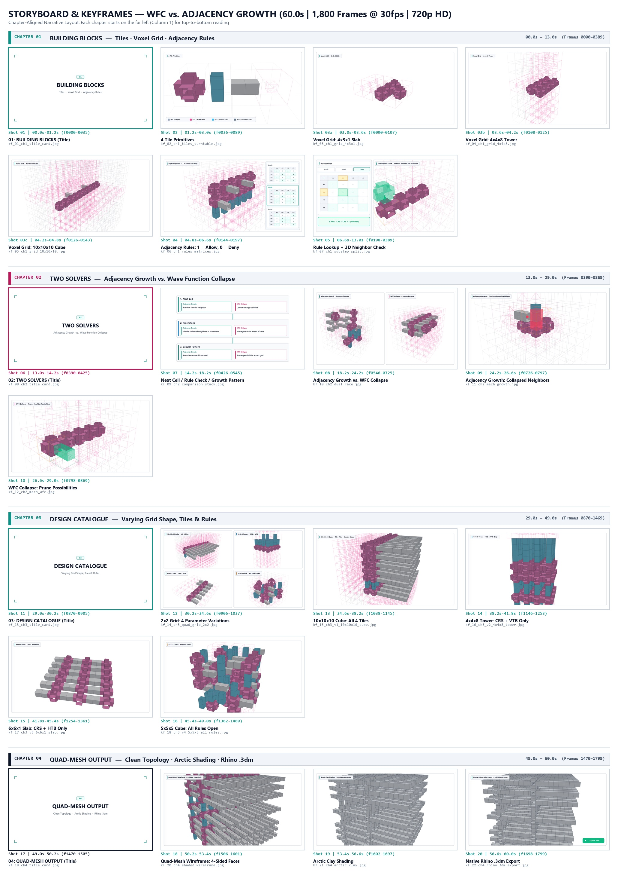

# Storyboard & Keyframes — WFC vs. Adjacency Growth (60s | 720p HD)

- **Master Video**: [`wfc_showcase_60s_720p.mp4`](file:///c:/Users/shajay.b/Documents/REPOS/ANTIGRAVITY%20REPOS/DRL/wfc_showcase_60s_720p.mp4) (`1280 × 720`, `30.00 fps`, `1,800 frames`, `60.00s`)
- **Storyboard Contact Sheet**: [`video_build/storyboard_contact_sheet.jpg`](file:///c:/Users/shajay.b/Documents/REPOS/ANTIGRAVITY%20REPOS/DRL/video_build/storyboard_contact_sheet.jpg)
- **Individual Keyframes Folder (`22` shots)**: [`video_build/keyframes/`](file:///c:/Users/shajay.b/Documents/REPOS/ANTIGRAVITY%20REPOS/DRL/video_build/keyframes)
- **All `1,800` Composited Master Frames**: [`video_build/frames/`](file:///c:/Users/shajay.b/Documents/REPOS/ANTIGRAVITY%20REPOS/DRL/video_build/frames) (`frame_0000.jpg` .. `frame_1799.jpg`)

---

## Chapter 01 — `TILES, RULES & VOXEL LATTICE` (`00.00s – 13.00s` | `f0000–0389`)

| Shot | Time (`f`) | Keyframe File | Description |
| :--- | :--- | :--- | :--- |
| **01** | `00.0s–01.2s` (`0000–0035`) | [`kf_01_ch1_title_card.jpg`](keyframes/kf_01_ch1_title_card.jpg) | Chapter 01 Title Card (`TILES, RULES & VOXEL LATTICE`) |
| **02** | `01.2s–03.0s` (`0036–0089`) | [`kf_02_ch1_tiles_turntable.jpg`](keyframes/kf_02_ch1_tiles_turntable.jpg) | `01 / 04` Quad-Mesh Tile Primitives (`NUL`, `CRS`, `VTB`, `HTB`) |
| **03a** | `03.0s–03.6s` (`0090–0107`) | [`kf_03_ch1_grid_4x3x1.jpg`](keyframes/kf_03_ch1_grid_4x3x1.jpg) | `02 / 04` Voxel Resolution `4×3×1` Planar Slab (`12` voxels) |
| **03b** | `03.6s–04.2s` (`0108–0125`) | [`kf_04_ch1_grid_4x4x8.jpg`](keyframes/kf_04_ch1_grid_4x4x8.jpg) | `02 / 04` Voxel Resolution `4×4×8` Vertical Tower (`128` voxels) |
| **03c** | `04.2s–04.8s` (`0126–0143`) | [`kf_05_ch1_grid_10x10x10.jpg`](keyframes/kf_05_ch1_grid_10x10x10.jpg) | `02 / 04` Voxel Resolution `10×10×10` Space-Frame (`1,000` voxels) |
| **04** | `04.8s–06.6s` (`0144–0197`) | [`kf_06_ch1_rules_matrices.jpg`](keyframes/kf_06_ch1_rules_matrices.jpg) | `03 / 04` 3-Axis `4×4` Adjacency Matrices (`X`, `Y`, `Z` socket rules) |
| **05** | `06.6s–13.0s` (`0198–0389`) | [`kf_07_ch1_substep_split.jpg`](keyframes/kf_07_ch1_substep_split.jpg) | `04 / 04` 1×2 Split Screen (`isAdjacentAllowed` inspector + 3D Sub-Step Rule Lookup, `16f` hold per check) |

---

## Chapter 02 — `ADJACENCY GROWTH VS. WFC COLLAPSE` (`13.00s – 29.00s` | `f0390–0869`)

| Shot | Time (`f`) | Keyframe File | Description |
| :--- | :--- | :--- | :--- |
| **06** | `13.0s–14.2s` (`0390–0425`) | [`kf_08_ch2_title_card.jpg`](keyframes/kf_08_ch2_title_card.jpg) | Chapter 02 Title Card (`ADJACENCY GROWTH VS. WFC COLLAPSE`) |
| **07** | `14.2s–18.2s` (`0426–0545`) | [`kf_09_ch2_comparison_stack.jpg`](keyframes/kf_09_ch2_comparison_stack.jpg) | Progressive 3-Stage Mechanism Comparison Stack (`Queue`, `When adjRules Queried`, `Uncollapsed State`) |
| **08** | `18.2s–24.2s` (`0546–0725`) | [`kf_10_ch2_dual_race.jpg`](keyframes/kf_10_ch2_dual_race.jpg) | 1×2 Dual Synchronized `6×6×6` Race (`Adjacency Growth` vs. `WFC Collapse`, `1 cell / 3 frames`) |
| **09** | `24.2s–26.6s` (`0726–0797`) | [`kf_11_ch2_mech_growth.jpg`](keyframes/kf_11_ch2_mech_growth.jpg) | `01 / 02` Adjacency Growth JIT `growth_filter` against collapsed neighbors (`12f` hold per check) |
| **10** | `26.6s–29.0s` (`0798–0869`) | [`kf_12_ch2_mech_wfc.jpg`](keyframes/kf_12_ch2_mech_wfc.jpg) | `02 / 02` WFC Recursive DFS `wfc_prop` domain pruning (`12f` hold per check) |

---

## Chapter 03 — `PARAMETER VARIATION CATALOGUE` (`29.00s – 49.00s` | `f0870–1469`)

| Shot | Time (`f`) | Keyframe File | Description |
| :--- | :--- | :--- | :--- |
| **11** | `29.0s–30.2s` (`0870–0905`) | [`kf_13_ch3_title_card.jpg`](keyframes/kf_13_ch3_title_card.jpg) | Chapter 03 Title Card (`PARAMETER VARIATION CATALOGUE`) |
| **12** | `30.2s–34.6s` (`0906–1037`) | [`kf_14_ch3_quad_grid_2x2.jpg`](keyframes/kf_14_ch3_quad_grid_2x2.jpg) | `2×2` Quad-Split Overview comparing all 4 parameter variations simultaneously |
| **13** | `34.6s–38.2s` (`1038–1145`) | [`kf_15_ch3_v1_10x10x10_cube.jpg`](keyframes/kf_15_ch3_v1_10x10x10_cube.jpg) | `01 / 04` `10×10×10` Cube (`All 4 Tiles`, `Socket` rules, `6,784` quads) |
| **14** | `38.2s–41.8s` (`1146–1253`) | [`kf_16_ch3_v2_4x4x8_tower.jpg`](keyframes/kf_16_ch3_v2_4x4x8_tower.jpg) | `02 / 04` `4×4×8` Vertical Tower (`CRS + VTB Only`, `Socket` rules, `1,784` quads) |
| **15** | `41.8s–45.4s` (`1254–1361`) | [`kf_17_ch3_v3_6x6x1_slab.jpg`](keyframes/kf_17_ch3_v3_6x6x1_slab.jpg) | `03 / 04` `6×6×1` Planar Slab (`CRS + HTB Only`, `Socket` rules, `576` quads) |
| **16** | `45.4s–49.0s` (`1362–1469`) | [`kf_18_ch3_v4_5x5x5_all_rules.jpg`](keyframes/kf_18_ch3_v4_5x5x5_all_rules.jpg) | `04 / 04` `5×5×5` High-Density Hybrid Cluster (`All 4 Tiles`, `All` rules `= 1`, `1,576` quads) |

---

## Chapter 04 — `QUAD-MESH TOPOLOGY & CAD EXPORT` (`49.00s – 60.00s` | `f1470–1799`)

| Shot | Time (`f`) | Keyframe File | Description |
| :--- | :--- | :--- | :--- |
| **17** | `49.0s–50.2s` (`1470–1505`) | [`kf_19_ch4_title_card.jpg`](keyframes/kf_19_ch4_title_card.jpg) | Chapter 04 Title Card (`QUAD-MESH TOPOLOGY & CAD EXPORT`) |
| **18** | `50.2s–53.4s` (`1506–1601`) | [`kf_20_ch4_shaded_wireframe.jpg`](keyframes/kf_20_ch4_shaded_wireframe.jpg) | `01 / 03` Shaded + Quad-Edge Wireframe (`8,320` quads, `33,280` vertices) |
| **19** | `53.4s–56.6s` (`1602–1697`) | [`kf_21_ch4_arctic_clay.jpg`](keyframes/kf_21_ch4_arctic_clay.jpg) | `02 / 03` `30`-frame Cross-Dissolve into `Arctic ✓` Clay Shading |
| **20** | `56.6s–60.0s` (`1698–1799`) | [`kf_22_ch4_rhino_3dm_export.jpg`](keyframes/kf_22_ch4_rhino_3dm_export.jpg) | `03 / 03` Native Rhino `.3dm` (`rhino3dm` WASM `addQuadFace`) Export |
